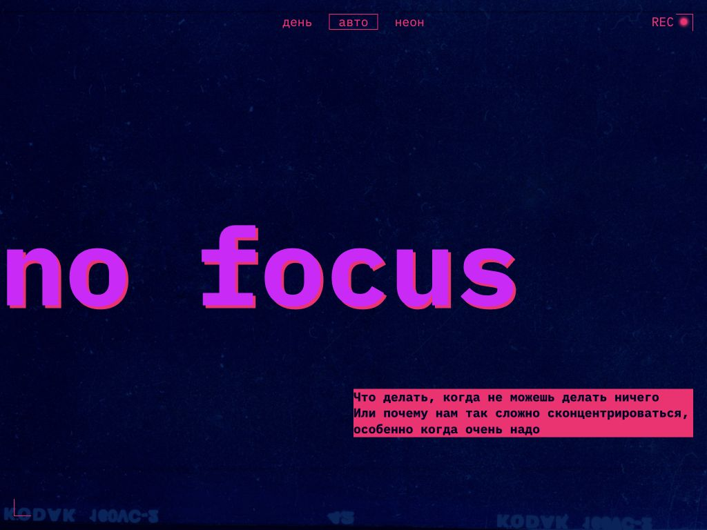

# Сложно сосредоточиться

Адаптивная страница о концентрации внимания — проект 4-го спринта Яндекс Практикума.

## Возможности

- Светлая, тёмная и автоматическая темы.
- Адаптивная вёрстка для телефона, планшета и компьютера.
- Сетка изображений и гибкая типографика.

## Технологии

HTML, CSS Grid, Flexbox, CSS-переменные, медиазапросы и JavaScript для переключения темы.

Репозиторий проекта: https://github.com/Saakoz14/slozhno-sosredotochitsya
